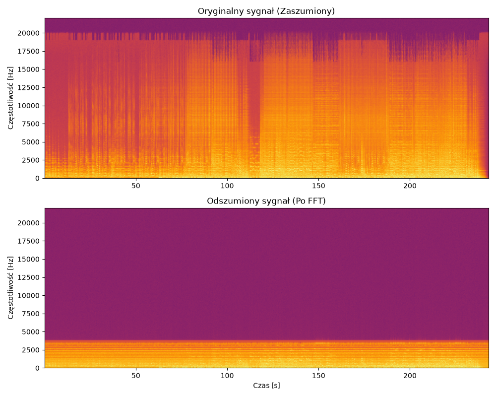

# Audio Signal Processing API 🎛️


A high-performance REST API for automated audio denoising. This project bridges the gap between scientific computing and modern backend engineering by wrapping low-level Fast Fourier Transform (FFT) algorithms into a fully containerized, asynchronous web service. 

Engineered with a focus on clean architecture, performance, and API documentation standards.

## Key Features

* **Spectral Gating Algorithm**: Utilizes FFT to analyze audio frequencies in the physical domain, isolating and filtering out low-amplitude background noise.
* **Modern Backend Stack**: Built with FastAPI for fast, asynchronous request handling and automatic OpenAPI documentation.
* **Automated Visual Analytics**: Generates comparative spectrograms (Before vs. After) on the fly using Matplotlib.
* **Containerized**: Fully configured `Dockerfile` ensures the environment is reproducible across any operating system without dependency conflicts.

## Tech Stack
* **Web Framework:** FastAPI, Uvicorn (ASGI)
* **Signal Processing:** NumPy, SciPy
* **Data Visualization:** Matplotlib
* **Infrastructure:** Docker

## Output Example



## How to Run

### Option 1: Using Docker
You can build and run the entire API in an isolated container with just two commands:

```bash
# Build the Docker image
docker build -t audio-api .

# Run the container on port 8000
docker run -p 8000:8000 audio-api
```


### Option 2: Local Python Environment


```
# Install required dependencies
pip install -r requirements.txt

# Start the ASGI development server
uvicorn main:app --reload
```


## API Usage

Once the server is running, navigate to: 👉 http://localhost:8000/docs

FastAPI automatically generates an interactive Swagger UI.

Expand the POST /api/v1/process-audio endpoint.

Click Try it out.

Upload any noisy .wav file.

Click Execute.

The API will process the data and return a downloadable .zip file containing the cleaned audio and the spectral analysis plot.
